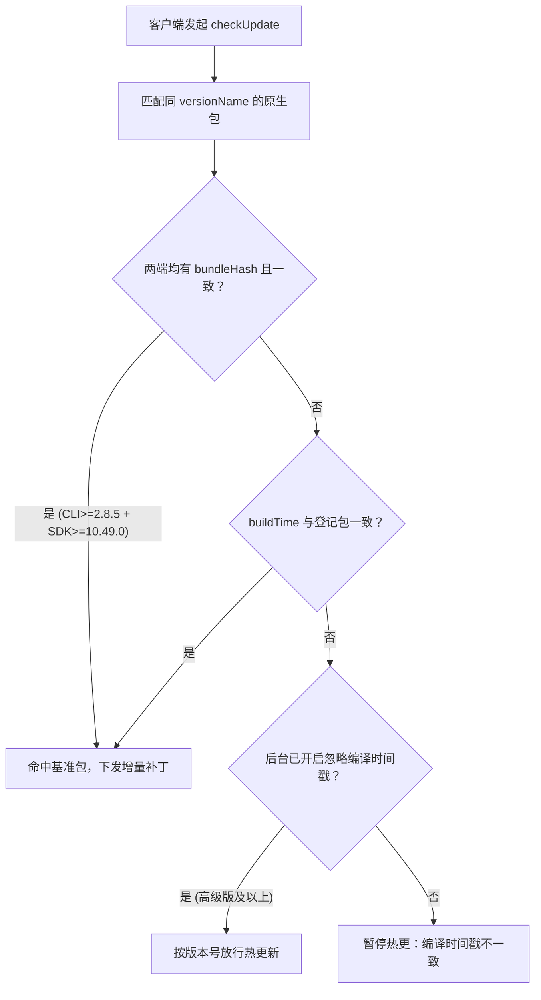

在国内安卓应用市场（华为、小米、OPPO、vivo、应用宝等）与出海 Google Play 并行的分发场景中，同一个 React Native 版本往往会产出几十个渠道 APK 甚至同时包含 `.apk` 与 `.aab` 两种格式。

如果每个渠道包都单独编译和上传，不仅耗时，还会迅速占满原生包配额。本指南总结 Pushy 在 Android 多渠道与 AAB 场景下的最小成本接入方案。

## Pushy 如何识别 Android 原生基准包

理解多渠道热更新的关键，在于服务端匹配原生基准包的三项元数据：

1. **原生版本号（`packageVersion`）**：取自 `android/app/build.gradle` 中的 `versionName`。
2. **编译时间戳（`buildTime`）**：Gradle 构建时自动写入安装包二进制的时间戳，可用 `pushy parseApk` 或 `pushy parseAab` 查看。
3. **内容指纹（`bundleHash`）**：使用 `react-native-update-cli >= 2.8.5` 上传原生包时，CLI 会从安装包内提取内置 JS Bundle 计算 `sha256`；当客户端集成的 `react-native-update >= 10.49.0` 时，检查更新请求会自动上报内置 Bundle 的 `bundleHash`。只要两边指纹一致，即使重新打包导致 `buildTime` 变化，服务端也会直接放行并复用同一份差量补丁。



基于这一机制，你可以根据团队当前的打包方式选择最省力的多渠道方案。

## 方案一：Walle / VasDolly 动态写入渠道号（国内多渠道首选）

如果各个安卓渠道包的 **JS 代码与内置静态资源完全一致**，仅仅需要区分统计渠道号（如 `huawei`、`xiaomi`、`oppo`），强烈推荐使用基于 APK Signature Scheme v2 分块注入渠道信息的方案：

- [美团 Walle](https://github.com/Meituan-Dianping/walle)
- [腾讯 VasDolly](https://github.com/Tencent/VasDolly)

### 为什么这是最佳方案

这类工具不会重新编译 Java/Kotlin 或重新打包 JS Bundle，而是直接基于**同一个母包 `app-release.apk`** 在签名块中秒级生成几十个渠道包：

- 所有渠道包的 `versionName`、`buildTime` 与内置 `index.android.bundle` **100% 相同**；
- 你只需要向 Pushy 上传**一次**母包（仅占用 1 个原生包配额）；
- 后续针对该母包发布的任何热更新或灰度策略，会自动对全部渠道包生效。

```bash
# 1. 打出唯一的签名母包（确保已设置 crunchPngs false）
cd android && ./gradlew clean assembleRelease

# 2. 只需将母包上传到 Pushy 一次
pushy uploadApk android/app/build/outputs/apk/release/app-release.apk

# 3. 用 Walle 或 VasDolly 基于该母包批量写出各渠道包并分发
```

在 JS 侧需要读取渠道号时，通过几行原生 Module 读取 Walle / VasDolly 写入的渠道字符串暴露给 JS 即可，避免把渠道名硬编码进 JS Bundle。

## 方案二：同时上架 Google Play（AAB）与国内渠道（APK）

许多应用需要把同一个版本同时上架 Google Play（强制要求 `.aab`）和国内应用市场或官网直装（要求 `.apk`）。

### 1. 在单次 Gradle 调用中同时产出 APK 与 AAB

切勿先跑一次 `./gradlew assembleRelease`，再单独跑一次 `./gradlew bundleRelease`——两次独立构建会触发两次写入，导致 `.apk` 与 `.aab` 带有不同的 `buildTime`。

请在根目录 `package.json` 中将两个任务放在**同一次 Gradle 调用**里执行：

```json
{
  "scripts": {
    "package:android:release": "cd android && ./gradlew clean assembleRelease bundleRelease"
  }
}
```

执行打包：

```bash
npm run package:android:release
```

同一次任务产出的两个包会共享同一份内置 Bundle 与一致的编译时间戳：

- APK：`android/app/build/outputs/apk/release/app-release.apk`
- AAB：`android/app/build/outputs/bundle/release/app-release.aab`

你只需将其中任意一个（例如 `pushy uploadAab` 或 `pushy uploadApk`，要求 `react-native-update-cli >= 2.6.0`）上传到 Pushy 登记为该 `versionName` 的基准包，Google Play 下载的用户与 APK 直装用户即可共享同一个热更新绑定。

### 2. 只打 AAB，并从中提取通用 APK

如果你希望构建流水线只执行 `bundleRelease`，也可以使用 CLI 内置的 `extractApk` 命令（需 `cli >= 2.6.0`）直接从 `.aab` 提取可安装的 APK：

```bash
# 上传 AAB 作为热更基准包
pushy uploadAab android/app/build/outputs/bundle/release/app-release.aab

# 从同一份 AAB 中提取包含全部分包的通用 APK
pushy extractApk android/app/build/outputs/bundle/release/app-release.aab \
  --includeAllSplits \
  --output app-universal-release.apk
```

也可以按目标架构和语言指定分包以减小直装 APK 体积：

```bash
pushy extractApk android/app/build/outputs/bundle/release/app-release.aab \
  --splits config.zh,arm64_v8a \
  --output app-arm64-release.apk
```

### 3. AAB 资源分割与 PNG 压缩注意事项

构建 Android Release 包（无论 APK 还是 AAB）前，请检查 `android/app/build.gradle` 中的两项配置：

1. **必须关闭 `crunchPngs`**：Android 构建期重压缩 PNG 会破坏增量图片补丁校验。

   ```groovy
   android {
       buildTypes {
           release {
               crunchPngs false
           }
       }
   }
   ```

2. **AAB 密度资源分割（`enableSplit`）**：
   - **`react-native-update >= 10.36.0`**：已原生适配 AAB 资源分割，**无需**关闭 `enableSplit`，可直接享受 Google Play 按屏幕密度瘦身的体积优势。
   - **`react-native-update < 10.36.0`**：若未升级 SDK，需在 `android.bundle.density` 中配置 `enableSplit = false`，否则热更新后可能出现图片无法显示的问题（见[安装配置](/docs/getting-started#禁用-aab-包的资源分割如果你需要在-google-play-上架)）。

## 方案三：Gradle Product Flavors 多变体构建

如果工程使用了 Gradle `productFlavors`（例如不同渠道有不同的桌面图标、推送 AppId、`AndroidManifest` 占位符或原生 SDK）：

### 情况 A：各 Flavor 的 JS 代码与内置静态资源完全一致

虽然每个 Flavor（如 `assembleHuaweiRelease`、`assembleXiaomiRelease`）会分别编译出独立的 APK 且 `buildTime` 不同，但只要：

1. `react-native-update >= 10.49.0`；
2. `react-native-update-cli >= 2.8.5`；
3. 各 Flavor 的 `versionName` 一致，且打包出的 JS Bundle 内容完全相同（不要在 Metro 打包期注入随 Flavor 变化的环境变量）。

那么所有 Flavor APK 的**内容指纹（`bundleHash`）完全相同**。你只需上传其中一个 Flavor 的 APK 作为该 `versionName` 的基准包，其余 Flavor 在检查更新时都会通过 `bundleHash` 自动匹配命中，无需逐个上传，也无需开启「忽略编译时间戳」。

### 情况 B：各 Flavor 的 JS 代码或内置资源存在差异

哪怕只有一行环境变量（如 `process.env.CHANNEL` 在打包期被内联进 JS）导致产出的 `index.android.bundle` 不同，不同 Flavor 的内置字节码就不再一致，无法共用同一份二进制差量补丁。此时有两种处理方式：

1. **推荐改造：把编译期差异下沉到运行时读取**。将渠道标识、API 环境等写入 `BuildConfig` 或 `AndroidManifest` `meta-data`，在应用启动后由原生层传给 JS。这样所有 Flavor 重新回到「情况 A」，共用同一份 JS Bundle 和热更包。
2. **独立维护**：如果不同变体确实包含不同的业务模块或品牌资源（如 OEM 贴牌包），建议为每个贴牌包在 Pushy 创建独立的应用（或使用带渠道后缀的 `versionName`，如 `2.1.0-oemA`），并在 CI 中通过 `--appId` 参数批量上传和发布（详见 [CI/CD 自动发布热更新](/docs/cicd)）。

## 方案四：管理后台「忽略编译时间戳」开关

对于历史遗留包（例如客户端 SDK 低于 `10.49.0` 无法上报 `bundleHash`，且多渠道已采用多次独立编译分发到线上），`高级版`、`专业版`与`大客户 VIP 版`可以在 [Pushy 管理后台](https://pushy-admin.reactnative.cn) 的「应用设置」中开启**忽略编译时间戳**。

- **生效逻辑**：服务端仅核对客户端上报的 `packageVersion` 是否绑定了热更版本，不再拦截 `buildTime` 不一致的设备。
- **权衡说明**：如果各渠道包内的基准 Bundle 实际上存在差异，增量补丁合并校验失败时客户端会自动回退到下载完整热更包（`.ppk`），因此比标准单母包方案消耗更多下行流量（Pushy 套餐内不额外收取 CDN 流量费，但弱网用户体验不如几十 KB 差量补丁轻快）。新发原生版本仍建议优先升级至 SDK `10.49.0+` 走内容指纹匹配。

## 常见问题

### 使用美团 Walle 或腾讯 VasDolly 打出 30 个渠道包，需要上传 30 次吗？

不需要。Walle 与 VasDolly 是在同一个签名母包上注入渠道信息，不会改动内置 JS Bundle 和编译时间戳。只需运行一次 `pushy uploadApk` 上传母包，30 个渠道包即可共享同一个热更新基准。

### 为什么后台已经显示了「内容指纹」，多 Flavor 包还是提示编译时间戳不一致？

内容指纹匹配需要服务端和客户端同时具备指纹：服务端通过 `react-native-update-cli >= 2.8.5` 上传原生包时提取指纹，而客户端需要集成 `react-native-update >= 10.49.0` 才会在检查更新请求中上报 `bundleHash`。若线上旧包内集成的 SDK 低于 `10.49.0`，服务端只能回退到严格比对 `buildTime`。排查细节参见[热更新不生效与回滚排查](/docs/troubleshooting)。

### Google Play 上架 AAB 后，应用内还能调用 downloadAndInstallApk 整包更新吗？

针对国内安卓渠道的直装 APK，可以在原生版本过期（`expired: true`）时引导下载新 APK；但对于 Google Play 渠道分发的版本，Google Play 政策禁止应用绕过商店自行下载安装 APK。建议针对 Play 渠道在检测到 `expired: true` 时使用 `Linking.openURL("market://details?id=你的包名")` 跳转商店更新页。

### 如何确认本地打出的 APK 和 AAB 编译时间戳是否一致？

在终端分别执行 `pushy parseApk app-release.apk` 和 `pushy parseAab app-release.aab`，对比输出的 `buildTime` 字段。只要通过同一次 `./gradlew clean assembleRelease bundleRelease` 构建，两者的版本号与编译时间戳就会保持一致。
