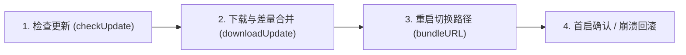

接入热更新后遇到「收不到更新」「下载成功但重启还是旧代码」「重启后自动回滚」或「热更后白屏 / 图片不显示」，通常都对应更新流水线中某个具体环节的配置遗漏。

本页按热更新从**检查 → 下载合并 → 重启加载 → 首启确认**的真实执行顺序，提供逐项排查清单。



:::tip 用 AI 自动诊断线上判定
如果你已经在 Claude Code、Cursor 等工具中配置了 [Pushy MCP 服务](/docs/mcp)，可以直接对 AI 说：「帮我排查应用 xxx 的 1.2.0 版本为什么没收到热更新」，MCP 会重放服务端判定并核对近期真实请求的编译时间戳、内容指纹与补丁产物状态。
:::

## 一、客户端检查不到更新（返回 `upToDate` 或 `paused`）

调用 `checkUpdate()` 没有拿到预期的新版本时，请依次核对以下五点：

### 1. 是否在 Debug 开发包中测试

默认情况下，开发模式（`__DEV__ === true`）不会发起热更新检查。

- 即使在 `new Pushy({ appKey, debug: true })` 中开启了 `debug: true`，也**仅能调试检查与下载流程**，无法真正加载热更 Bundle（因为 Debug 模式下原生端固定从 Metro Server 加载脚本）。
- **验证热更新生效必须打正式 Release 离线包**（iOS Archive IPA、Android `assembleRelease` APK 或鸿蒙 `.app`）。

### 2. 热更包是否已绑定到目标原生包版本

运行 `pushy bundle` 或 `pushy publish` 仅把 `.ppk` 上传到了服务端；**未绑定任何原生包版本前，不会有任何设备收到该更新**。

- 登录 [Pushy 管理后台](https://pushy-admin.reactnative.cn) 或运行 `pushy packages --platform <ios|android|harmony>`，确认当前客户端的 `packageVersion` 已绑定到目标热更版本。
- 若绑定时设置了灰度比例（如 `--rollout 10`），未命中的 90% 设备会继续保持当前全量版本；QA 验收建议优先使用[扫码测试](/docs/bestpractice#测试与回滚)直接拉取指定版本。

### 3. 编译时间戳（`buildTime`）或内容指纹不一致

如果 `updateInfo` 或日志中提示 `编译时间戳与服务器记录不一致`：

- 说明测试机上安装的原生包与 `pushy uploadApk / uploadIpa / uploadApp` 上传登记的**不是同一次编译产物**（例如上传后又重新运行了一次 Archive 或 `assembleRelease`，却没改版本号重新上传）。
- 用 `pushy parseApk` / `parseIpa` / `parseAab` 查看安装包内的真实 `buildTime`，与后台登记值核对。
- 将 SDK 升级到 `react-native-update >= 10.49.0` 并使用 `react-native-update-cli >= 2.8.5` 上传基准包后，服务端会优先按内置 Bundle 的**内容指纹（`bundleHash`）**放行，彻底避免同代码重复打包引发的时间戳拦截。多渠道场景详见 [Android 多渠道打包与 AAB 热更新](/docs/android-channels-and-aab)。

### 4. 应用或配额处于暂停状态（`updateInfo.paused`）

打印 `updateInfo` 查看是否包含 `paused` 字段：

- `paused: "app"` 或 `"package"`：后台手动暂停了整个应用或当前原生版本的热更新下发。
- `paused: "quota"`：账号当日累计热更新查询次数已达到当前套餐上限（次日零点自动恢复，或前往[价格页](/pricing)升级套餐 / 加购查询额度）。

### 5. `appKey` 混用或原生配置归属冲突

- 检查 `update.json` 中 `ios`、`android`、`harmony` 三个平台的 `appKey` 是否正确按 `Platform.OS` 读取，避免把 Android 的 `appKey` 传给了 iOS 客户端。
- 如果工程接入了[原生主动检测与更新](/docs/native-api)（v10.59.0+），请确认 `nativeConfigSource: "native"` 与原生 `configure` 传入的 `appKey` 一致，且未将 `disabled` 设为 `true`。

## 二、下载失败或增量补丁合并失败（`patch_fail`）

如果在后台「版本健康度」或客户端 `logger` 中看到 `errorUpdate` / `patch_fail`：

### 1. Android 未关闭 `crunchPngs`

Android Gradle 默认会在构建 Release APK 时重压缩 PNG 图片，导致客户端安装包内的图片字节流与原始源码不一致，增量补丁校验失败。请确认 `android/app/build.gradle` 中已配置：

```groovy
android {
    buildTypes {
        release {
            crunchPngs false
        }
    }
}
```

修改后需递增 `versionName`、重新打包并执行 `pushy uploadApk` 登记新基准包。

### 2. Expo 项目同时安装了 `expo-updates`

在 Expo Prebuild 项目中使用 Pushy 时，若 `package.json` 中仍保留 `expo-updates`，两套原生 Bundle 加载器会互相抢占控制权。请卸载 `expo-updates` 并重新执行 `npx expo prebuild --clean` 编译原生工程，详见 [Expo 项目接入指南](/docs/expo)。

## 三、下载成功，但重启后仍是旧版本或自动回滚

这是集成阶段最高频的问题，成因非常明确——主要集中在**原生入口未替换 Bundle 路径**或**新代码首启崩溃触发保护回滚**。

### 1. 原生端未正确接入 `bundleURL` / `getBundleUrl`

如果客户端下载热更成功、重启后既没有崩溃日志、却依然展示旧界面（且紧接着又检测到同一个热更新），99% 是原生层仍在加载安装包内置的离线 Bundle，导致 Pushy 在重启后发现热更路径未生效而回滚：

- **iOS（特别注意 RN 0.88+ `SceneDelegate` 迁移）**：
  - RN 0.88 起默认模板将启动入口移至 `SceneDelegate.swift`，必须在非 `DEBUG` 分支返回 `RCTPushy.bundleURL()`；若从 RN 0.87 及以下升级上来，请检查是否把旧 `AppDelegate` 中的 `RCTPushy.bundleURL()` 漏在了未生效的类里。
  - Objective-C 项目请确认 `#import "RCTPushy.h"` 没有被误包在 `#if DEBUG` 条件编译块内部。
- **Android（区分新旧架构）**：
  - RN 0.82+ 新架构：必须在 `MainApplication.kt` 的 `getDefaultReactHost` 中传入 `jsBundleFilePath = UpdateContext.getBundleUrl(this)`。
  - RN 0.81 及以下：在 `DefaultReactNativeHost` 中重写 `getJSBundleFile()` 返回 `UpdateContext.getBundleUrl(this@MainApplication)`。
  - **Brownfield 原生混编项目**：除了传入 `jsBundleFilePath`，若需要 `switchVersion()` 立即重载生效，还需在宿主 `Application` 暴露 public 的 `getReactHost()` 方法，详见[原生 App 混编集成](/docs/brownfield)。
- **HarmonyOS**：确认 `Index.ets` 的 `AnyJSBundleProvider` 数组中，`new PushyFileJSBundleProvider(...)` 排在内置 `ResourceJSBundleProvider` **之前**。

完整各端代码模板请核对[安装配置 - 配置 Bundle URL](/docs/getting-started#配置-bundle-url)。

### 2. 未等待 `downloadUpdate()` 完成就调用了 `switchVersion()`

在自定义更新界面时，**切勿根据 `progress.received === progress.total` 触发重启**——字节流接收完毕后客户端还需在本地完成解压与bsdiff/hdiff 补丁合并。必须在 `if (await downloadUpdate())` 返回 `true` 之后再调用 `switchVersion()` 或 `switchVersionLater()`。

### 3. 新热更版本首屏抛错，触发崩溃保护自动回滚

Pushy 具备首启崩溃保护：如果切换到新热更版本后，应用在完成首屏初始化并自动标记成功前发生了未捕获 JS 异常或原生闪退，下次启动会自动回滚到上一个稳定版本，并在 `logger` 中抛出 `type: "rollback"` 事件。

排查方法：

1. **查看后台 JS 报错监控**：若客户端 `react-native-update >= 10.55.0` 且打包时生成了 sourcemap，直接在后台打开[JS 报错监控](/docs/errors)，即可看到导致回滚的源码文件名、行号与前后代码片段。
2. **检查是否不小心引入了新原生模块**：如果在热更迭代中 `npm install` 了包含原生代码的新第三方库，JS 调用不存在的 NativeModule / TurboModule 会立即报错并触发回滚。含原生代码变更必须重发原生包。
3. **Sentry 等原生采样 SDK 重启冲突**：若使用 `switchVersion()` 立即销毁重建 RN 实例时偶发原生层崩溃，可升级至 `v10.42.2+` 配置 [`beforeReload`](/docs/api#beforereload-示例重启前清理原生-sdk) 先停止 profiling 并 flush 队列，或改用更温和的 `switchVersionLater()`（下次冷启动生效）。

## 四、热更重启后白屏或图片资源不显示

### 1. Android 热更立即重启后白屏（`react-native-screens`）

如果项目安装了 `react-native-screens`（使用 React Navigation 或 Expo Router 的工程默认包含），Android 在热更立即重启恢复 Fragment 状态时可能出现白屏或崩溃。

请在 `MainActivity.kt`（注意是 `MainActivity` 而非 `MainActivityDelegate`）的 `onCreate` 中配置 `RNScreensFragmentFactory`：

```kotlin
import android.os.Bundle
import com.swmansion.rnscreens.fragment.restoration.RNScreensFragmentFactory

class MainActivity : ReactActivity() {
  override fun onCreate(savedInstanceState: Bundle?) {
    supportFragmentManager.fragmentFactory = RNScreensFragmentFactory()
    super.onCreate(savedInstanceState)
  }
}
```

### 2. 热更新后部分图片不显示

- **检查引用方式**：只有通过静态 `require('./img/banner.png')` 或 `import` 被 Metro 打包进资产表的图片才会随 `.ppk` 下发；放在原生 `xcassets` / `res/drawable` 中按原生资源名加载的图片属于原生资产，不能通过热更新新增。
- **第三方图片组件协议兼容**：热更新后的静态资源存放在沙盒目录，运行时路径从内置资源变为 `file://` 协议。极少数老旧自定义原生组件未处理 `file://` 前缀时会加载失败，建议优先使用官方 `<Image>` 或主流维护良好的图片库（如 `expo-image`、`react-native-fast-image` 新版）。
- **低版本 SDK 的 AAB 分包问题**：若上架 Google Play `.aab` 且 `react-native-update < 10.36.0`，需升级 SDK 至 `10.36.0+` 或关闭 `bundle.density.enableSplit`。

## 五、线上事故急救：坏热更把 JS 打死（「变砖」）怎么办？

如果某次问题热更在应用已经完成首启标记后（例如依赖特定服务端接口返回触发致命白屏）导致 JS 逻辑彻底卡死，常规写在 JS 里的 `checkUpdate` 将无法再执行：

1. **立即止损**：第一时间在 [Pushy 管理后台](https://pushy-admin.reactnative.cn) 将该原生包的绑定切回上一个正常版本，或暂停下发，阻断更多设备受影响。
2. **使用「强制启动（救砖）」拉回已中招设备**：只要线上原生包集成的 `react-native-update >= 10.52.1`（且未手动设置 `disableNativeCheck: true`），每次冷启动几秒后原生层都会独立发起后台检测。验证修复包无误后，在后台选择**全量 + 强制启动（救砖）**发布，原生检测通道就会越过挂死的 JS 直接拉取修复包并在下次启动恢复正常，详见[强制启动说明](/docs/publish#强制启动救砖)。
3. **客服单机兜底**：在「关于我们」隐藏手势或远程配置开关中接入 [`resetToPackagedBundle({ restart: true })`](/docs/api#async-function-resettopackagedbundleoptions)（需 `v10.48.0+`），可随时将单台异常设备一键清空热更缓存、恢复回安装包出厂状态。

## 常见问题

### 为什么模拟器或真机连着 Xcode / Android Studio 直接 Run 无法测试热更新？

IDE 直接 Run 默认构建的是 Debug 变体，iOS `bundleURL()` 中的 `#if DEBUG` 分支和 Android Debug 模式都会强制连接本地 Metro 开发服务器，不会读取 Pushy 下载的离线热更包。测试热更新切换请务必构建并安装 Release 包。

### 热更新失败回滚后，同一台设备还会反复下载这个坏版本形成死循环吗？

不会。Pushy 在设备本地维护了回滚记录（`rolledBack` 保护）：一旦某个热更版本 `hash` 在该设备上因启动崩溃发生回滚，客户端会自动拒绝再次应用同一个坏 `hash`，直到你发布了新的修复版本（生成新的 `hash`）。

### 如何捕获热更新全流程的状态用于自建监控告警？

自 `v10.47.0` 起，Pushy 管理后台已内置免配置的「版本健康度」大盘（自动统计下载失败率、`patch_fail` 与 `rollback`）。如需同时上报到团队自建的埋点系统（如 Firebase、神策或阿里云 SLS），可在 `new Pushy({ appKey, logger, afterCheckUpdate })` 中传入回调接收全生命周期事件。

### 扫码测试热更新为什么扫完没有任何反应？

请确认三点：1）不要用微信扫一扫（微信会拦截自定义 Scheme），请使用系统相机或系统扫一扫；2）若勾选了「使用 Deep Link」，客户端需已按文档在原生配置好对应协议名并重新编译；3）若使用了自定义更新界面（`updateStrategy: null`），必须从 `useUpdate()` Hook 读取 `updateInfo` 响应更新，不能只依赖手动调用 `checkUpdate()` 的返回值。
